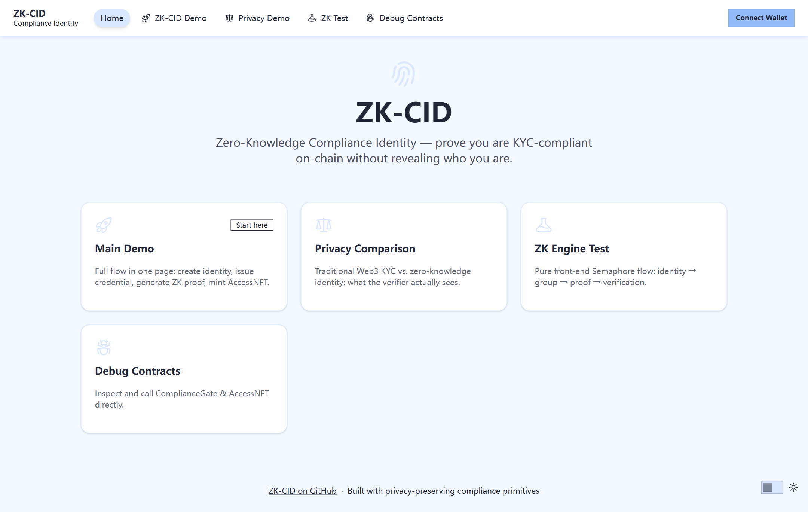
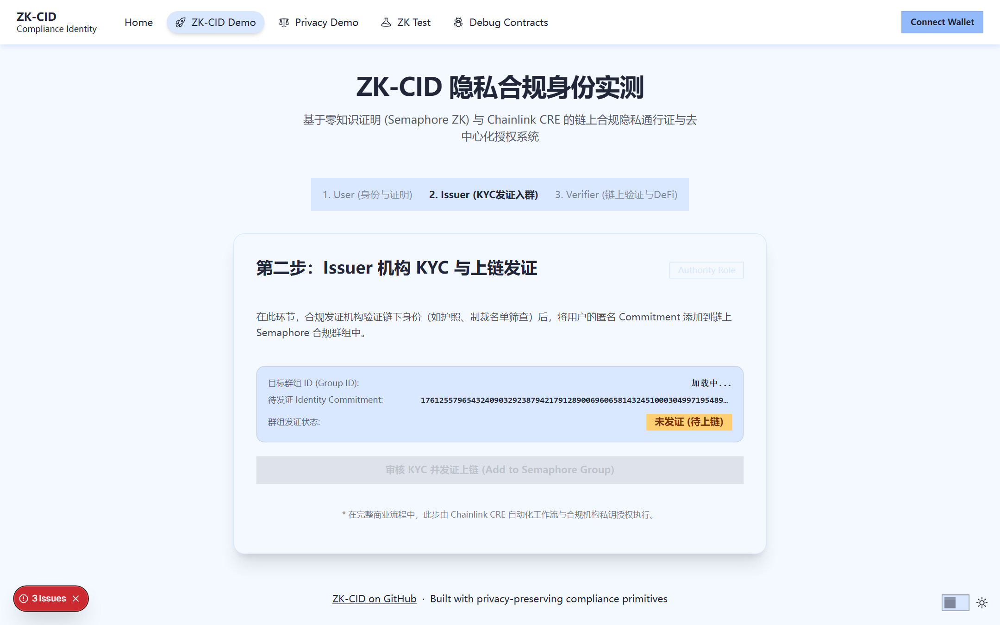
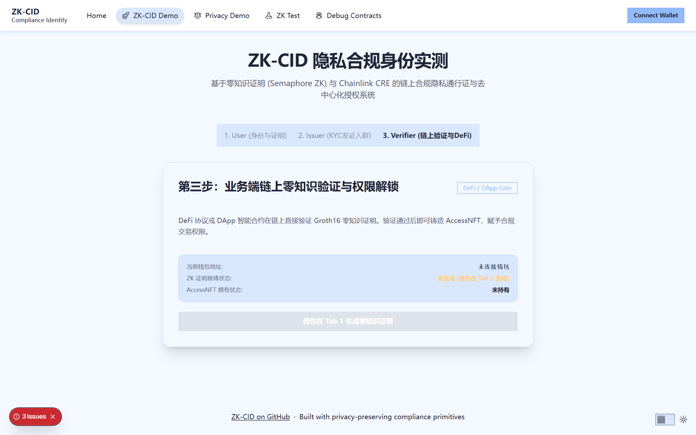
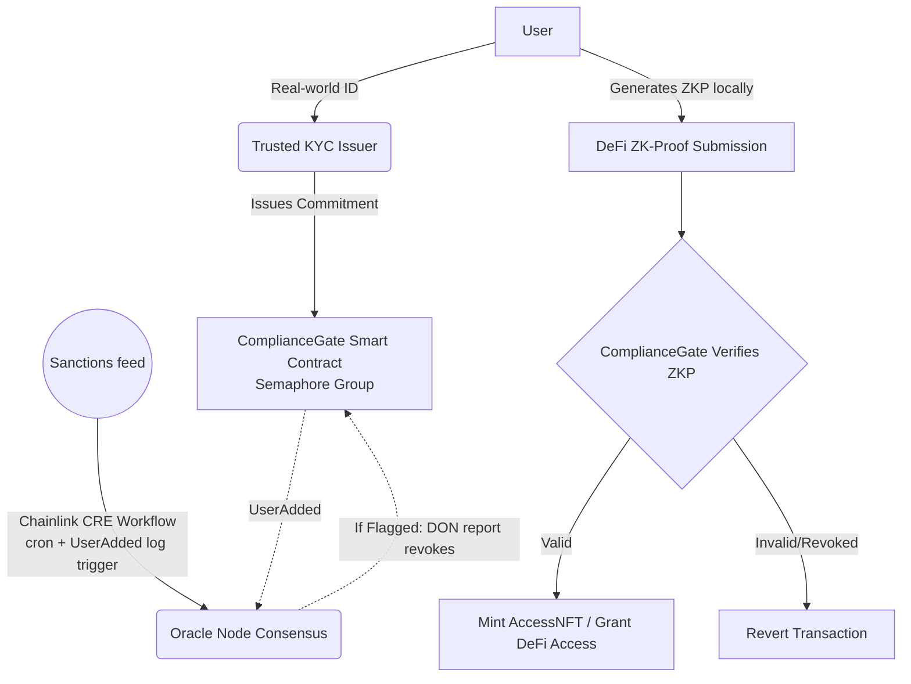

# ZK-CID 🛡️
**Zero-Knowledge Compliance Identity & Decentralized Workflow Orchestration**

[](https://github.com/juangh123/WEB-3.0-Decentralized/actions/workflows/ci.yml)

> **Prove you are compliant, protect who you are.** Users prove KYC/sanctions compliance with a
> zero-knowledge proof instead of revealing their identity, and a Chainlink CRE workflow keeps
> that status current by revoking credentials automatically when the sanctions feed changes.

🏆 **BLI Legal Tech Hackathon 2** (LegalTech & RegTech) · **Chainlink CRE: Best workflow with CRE**

🌐 **Live demo**: <https://web-3-0-decentralized.vercel.app/zk-cid> (no wallet needed for the
full ZK check, see the judge path below)

🎥 **Pitch video**: [2:48, English](https://web-3-0-decentralized.vercel.app/demo/zk-cid-pitch-video-en.mp4) ·
[strict-mode acceptance clip, 34 s](https://web-3-0-decentralized.vercel.app/demo/zk-cid-strict-mode-acceptance.mp4)

| Landing | Issuer (KYC → on-chain credential) | Verifier (ZK proof → AccessNFT) |
| --- | --- | --- |
|  |  |  |

## Hackathon Submission

- **Event**: [BLI Legal Tech Hackathon 2 (legal-hack-2026)](https://dorahacks.io/hackathon/legal-hack-2026)
- **Deadline**: 2026-11-01 01:01 UTC (Beijing time 09:01)
- **Track**: `All BUIDLs` (the only selectable track; LegalTech & RegTech is a category inside it)
- **Bounty**: [Chainlink CRE — Best Workflow with CRE](https://dorahacks.io/hackathon/bounty/1362)
- **Submission**: [ZK-CID on DoraHacks](https://dorahacks.io/buidl/48603)

## Judge Quick Path (3 minutes, no wallet)

1. Open the [main demo](https://web-3-0-decentralized.vercel.app/zk-cid) and generate a random
   anonymous identity (it never leaves the browser).
2. **Tab 2 · Issuer** → **Demo issuer (testnet only)** adds only your commitment to the
   on-chain Semaphore group on Sepolia.
3. **Tab 1** → **Generate ZK proof** (computed locally).
4. **Tab 3** → **Verify proof without gas** runs `AccessNFT.mint` as an `eth_call` against the
   live contracts, so the real Semaphore v4 verifier checks your proof in strict mode. No
   transaction, no testnet ETH.
5. Optional: connect a wallet with Sepolia ETH, regenerate the proof and mint the AccessNFT.

## Verify It Yourself

```bash
cd zk-cid
yarn install --immutable
yarn test                                          # contracts (34) + frontend unit (12) + CRE logic + mock API (13)
yarn workspace compliance-lifecycle test:sim       # CRE workflow simulation: 11 workflow tests + 3 Poseidon vectors
yarn workspace compliance-lifecycle compile:cre    # compile the workflow to CRE WASM
yarn next:build                                    # frontend production build
yarn e2e:install                                   # one-time Chromium download
yarn e2e                                           # Playwright E2E (uses the build above)
yarn npm audit -A --severity high                  # dependency gate (must be clean)
```

The Chainlink CRE workflow is also verified with the official CLI: `cre workflow build` and
`cre workflow simulate` both run end to end
([raw log](zk-cid/workflows/compliance-lifecycle/evidence/cre-simulate-20261002-232950.log)):
DON-consensus fetch of the sanctions API, `getMembers()`/`getLeaves()` reads against the
Sepolia deployment, Semaphore-tree rebuild with real Merkle siblings, and the revoke branch
(`{"status":"revoked","revokedCount":1}`).

A real broadcast rehearsal produced an actual on-chain revocation:
[tx `0xb64c050e…`](https://eth-sepolia.blockscout.com/tx/0xb64c050e37d7959951510eae66cc6994e11a7f640f8c4699f0d7e1050713e4d9)
removed the credential from the live Semaphore tree
(`getMembers()` went from one member to none). Caveats and the mock-vs-production
forwarder setup are documented in
[`cre-broadcast-evidence.md`](zk-cid/workflows/compliance-lifecycle/evidence/cre-broadcast-evidence.md).

The workflow has two handlers: a **cron trigger** that re-screens every member, and an
**EVM log trigger on `ComplianceGate.UserAdded`** that screens each new credential at the
moment of issuance. Both are covered by the SDK TestRuntime tests; the evidence summary is in
[`evidence/README.md`](zk-cid/workflows/compliance-lifecycle/evidence/README.md).

Sepolia deployment, transaction hashes and the CRE evidence chain are documented in
[zk-cid/SEPOLIA_DEPLOYMENT.md](zk-cid/SEPOLIA_DEPLOYMENT.md). Known limitations are listed
in [zk-cid/README.md](zk-cid/README.md#known-limitations).

## Live Deployment

- **ComplianceGate (Sepolia)**: `0x1b8ae78C37c3E29DFcB0236E1c562b3CCFA44F70`
- **AccessNFT (Sepolia)**: `0x7A52459d8eEF432fa3F044c152dd36ba1F3F931f`
- **Mock sanctions API**: [https://mock-api-topaz-zeta.vercel.app/api/sanctions-list](https://mock-api-topaz-zeta.vercel.app/api/sanctions-list)
- **Verified source**: [ComplianceGate](https://eth-sepolia.blockscout.com/address/0x1b8ae78C37c3E29DFcB0236E1c562b3CCFA44F70#code) · [AccessNFT](https://eth-sepolia.blockscout.com/address/0x7A52459d8eEF432fa3F044c152dd36ba1F3F931f#code) (Blockscout + Sourcify)
- **CRE write path**: [ComplianceGateReceiver](https://eth-sepolia.blockscout.com/address/0xB5ad6413a16efd82b76212830f908B2D67C20425#code) `0xB5ad6413a16efd82b76212830f908B2D67C20425` — accepts DON reports from the Sepolia Keystone forwarder and forwards them to the gate; `ComplianceGate.creWorkflow` points at it

## Quick Overview

Current Web3 compliance is flawed: users leak privacy to centralized KYC gates, and manual
revocation of sanctioned identities is slow.

ZK-CID solves this with a **Dual-Trust Engine**:
- **Zero-Knowledge Privacy (Semaphore v4)**: users generate local identities. Issuers only put
  anonymous commitments on-chain. Users generate ZK proofs to access DeFi, keeping their real
  identity decoupled from their wallet.
- **Decentralized Automated Revocation (Chainlink CRE)**: serverless workflows watch an
  external sanctions feed on a schedule and at every issuance. If a credential holder is
  flagged, a DON-signed report revokes the credential on-chain.

The same primitive also covers **age assurance**: an "over 18" group lets a service keep minors
out without ever collecting a minor's personal data (see the
[regulatory mapping](zk-cid/deliverables/LEGAL_MAPPING.md)).

## Architecture



## Repository Structure

The complete source code is located in the `zk-cid` subdirectory:

- `zk-cid/packages/hardhat/` - Smart contracts (ComplianceGate / AccessNFT / CRE receiver)
- `zk-cid/packages/nextjs/` - dApp frontend (identity, proof, verification)
- `zk-cid/workflows/compliance-lifecycle/` - Chainlink CRE workflow
- `zk-cid/mock-api/` - Mock sanctions API
- `docs/internal/` - Internal working notes and audit history (Chinese)

Please navigate to [zk-cid/README.md](zk-cid/README.md) for detailed setup instructions and
the local end-to-end guide.
