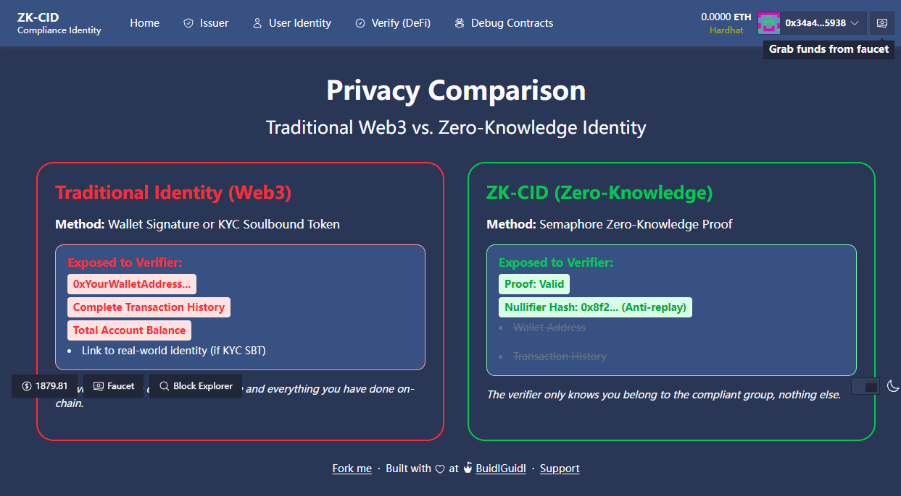
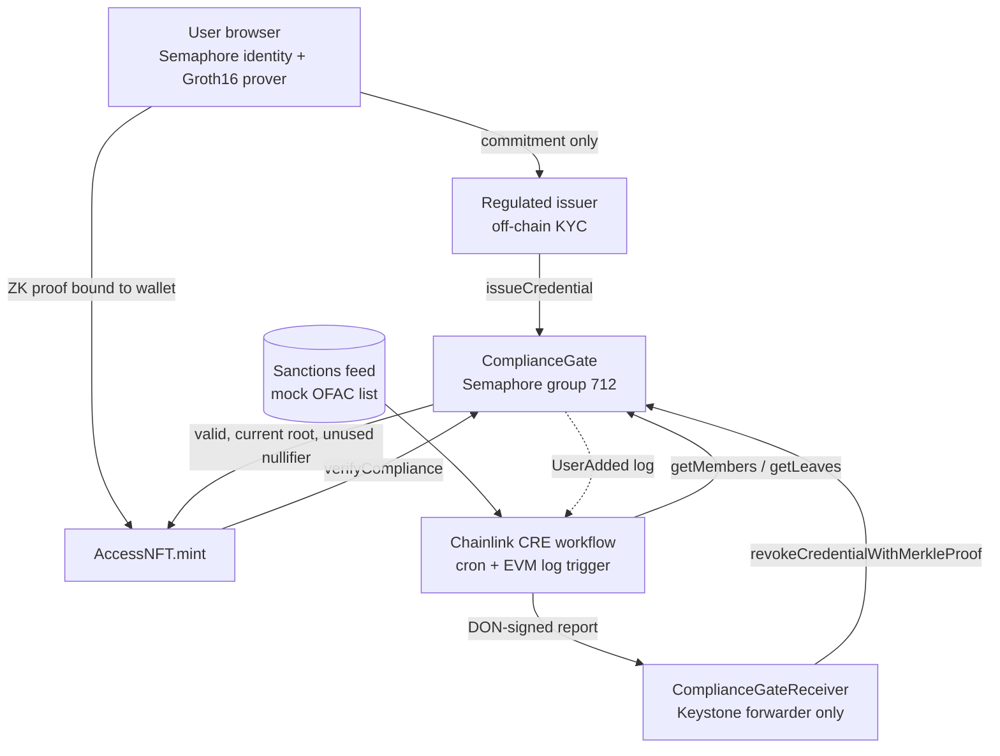

# ZK-CID 🛡️

**Zero-Knowledge Compliance Identity & Decentralized Workflow Orchestration**

> Prove you are compliant, protect who you are. ZK-CID lets a user prove "I passed KYC and I
> am not sanctioned" with a zero-knowledge proof, and a Chainlink CRE workflow keeps that
> status current by revoking credentials automatically when the sanctions feed changes.



Built for the **BLI Legal Tech Hackathon 2** (category: LegalTech & RegTech) and the
**Chainlink CRE "Best workflow with CRE"** bounty.

| | |
| --- | --- |
| Live demo | <https://web-3-0-decentralized.vercel.app/zk-cid> |
| Pitch video (2:48) | <https://web-3-0-decentralized.vercel.app/demo/zk-cid-pitch-video-en.mp4> |
| Strict-mode acceptance clip (34 s) | <https://web-3-0-decentralized.vercel.app/demo/zk-cid-strict-mode-acceptance.mp4> |
| CRE evidence | [`workflows/compliance-lifecycle/evidence/`](./workflows/compliance-lifecycle/evidence/README.md) |
| Sepolia deployment | [`SEPOLIA_DEPLOYMENT.md`](./SEPOLIA_DEPLOYMENT.md) |
| Regulatory mapping | [`deliverables/LEGAL_MAPPING.md`](./deliverables/LEGAL_MAPPING.md) |

## Judge quick path (3 minutes, no wallet needed)

1. Open the [main demo](https://web-3-0-decentralized.vercel.app/zk-cid) and click
   **Generate random anonymous identity**. The Semaphore identity and its secret stay in
   your browser.
2. **Tab 2 · Issuer**: click **Demo issuer (testnet only)**. A server-side issuer adds only
   your public commitment to the on-chain Semaphore group on Sepolia; its key never reaches
   the browser.
3. **Tab 1**: click **Generate ZK proof**. The Groth16 proof is computed locally. Without a
   wallet it is bound to a throwaway address.
4. **Tab 3 · Verifier**: click **Verify proof without gas**. The page runs `AccessNFT.mint`
   as an `eth_call` against the live Sepolia contracts, so the real Semaphore v4 verifier
   checks your proof in strict mode. Nothing is broadcast and no testnet ETH is needed.
5. Optional: connect a wallet with a little Sepolia ETH, regenerate the proof, and mint the
   AccessNFT for real.
6. The **CRE data source** panel shows the live sanctions feed intersected with the on-chain
   members, and links to the CLI simulation log and the on-chain revocation produced by the
   workflow.

Local alternative without testnet funds: `yarn chain` + `yarn deploy` + `yarn start` (see
[Quickstart](#quickstart-local)).

## Problem

Web3 compliance forces a bad trade-off:

1. **Verifier-side privacy leaks.** Classic KYC gates ask users to reveal who they are to every
   protocol, building honeypots of personal data and conflicting with GDPR data minimisation.
2. **Issuer-side trust and stale status.** Compliance status (for example an OFAC listing) is
   maintained by hand in centralised systems. Revocations are slow and depend on a single
   operator.

## Solution

ZK-CID separates "prove compliance" from "reveal identity" and automates the revocation side:

- **Zero-knowledge membership (Semaphore v4).** A regulated issuer KYCs the user off-chain and
  adds only an anonymous commitment to an on-chain group. The user proves membership with a
  zero-knowledge proof, so a DeFi protocol learns "this wallet belongs to a compliant person"
  and nothing else. The proof is bound to the submitting wallet (`proof.message ==
  msg.sender`) and every nullifier is single-use, which blocks front-running and replay.
- **Decentralized revocation (Chainlink CRE).** A CRE workflow screens members against an
  external sanctions feed on a schedule **and** whenever a new credential is issued, reaches
  DON consensus on the feed, rebuilds the Semaphore tree, and removes listed members on-chain
  through a DON-signed report.

## Architecture



| Layer | Stack |
| --- | --- |
| Zero knowledge | Semaphore v4 (Groth16, LeanIMT) |
| Contracts | Solidity ^0.8.23 (compiled with 0.8.28), Hardhat 3, OpenZeppelin |
| Frontend | Next.js App Router, Scaffold-ETH 2, wagmi, viem, DaisyUI |
| Orchestration | Chainlink CRE TypeScript SDK 1.16.0, official CRE CLI 1.36.0 |
| Off-chain data | Mock sanctions API on Vercel with a unified JSON schema |

## Chainlink CRE workflow

`workflows/compliance-lifecycle/` is a real CRE workflow, not a script that imitates one.

| Handler | Trigger | What it does |
| --- | --- | --- |
| 0 | Cron, every 5 minutes | Screens every active member: HTTP fetch with identical-result DON consensus → `getMembers()` / `getLeaves()` at the finalized block → intersect → rebuild the Semaphore tree → DON-signed report → `writeReport` revokes each hit |
| 1 | EVM log trigger on `ComplianceGate.UserAdded`, `FINALIZED` | Screening at issuance: checks only the new commitment and revokes it immediately if it is listed |

Evidence (details in [`evidence/README.md`](./workflows/compliance-lifecycle/evidence/README.md)):

- **Official CRE CLI v1.36.0** builds the workflow and `cre workflow simulate` runs the cron
  handler end to end against live Sepolia state, ending in
  `{"status":"revoked","revokedCount":1}` ([raw log](./workflows/compliance-lifecycle/evidence/cre-simulate-20261002-232950.log)).
- **A real on-chain revocation** produced by the workflow's report:
  [tx `0xb64c050e…`](https://eth-sepolia.blockscout.com/tx/0xb64c050e37d7959951510eae66cc6994e11a7f640f8c4699f0d7e1050713e4d9)
  removed the member from the live Semaphore tree (rehearsal through the MockKeystoneForwarder;
  caveats in [`cre-broadcast-evidence.md`](./workflows/compliance-lifecycle/evidence/cre-broadcast-evidence.md)).
- **Production write path**: `ComplianceGateReceiver`
  ([verified source](https://eth-sepolia.blockscout.com/address/0xB5ad6413a16efd82b76212830f908B2D67C20425#code))
  follows the official `ReceiverTemplate` pattern and only accepts the Sepolia Keystone forwarder.
- **SDK TestRuntime simulation**: 11 workflow tests cover both handlers, batching, malformed
  feeds, failed writes and misrouted logs (`yarn workspace compliance-lifecycle test:sim`).
- Running `simulate` surfaced three real runtime defects (a browser-only `atob` dependency,
  a `process` global, and a shadowing `project.yaml`), all fixed and documented.

## Live Sepolia deployment

| Item | Value |
| --- | --- |
| ComplianceGate v2.2 | [`0x1b8ae78C37c3E29DFcB0236E1c562b3CCFA44F70`](https://eth-sepolia.blockscout.com/address/0x1b8ae78C37c3E29DFcB0236E1c562b3CCFA44F70#code) |
| AccessNFT v2 | [`0x7A52459d8eEF432fa3F044c152dd36ba1F3F931f`](https://eth-sepolia.blockscout.com/address/0x7A52459d8eEF432fa3F044c152dd36ba1F3F931f#code) |
| ComplianceGateReceiver | [`0xB5ad6413a16efd82b76212830f908B2D67C20425`](https://eth-sepolia.blockscout.com/address/0xB5ad6413a16efd82b76212830f908B2D67C20425#code) |
| Semaphore v4 | `0x8A1fd199516489B0Fb7153EB5f075cDAC83c693D` |
| Mode | `demoMode = false` (strict Semaphore verification since 2026-10-10) |
| Mock sanctions API | <https://mock-api-topaz-zeta.vercel.app/api/sanctions-list> |

All three contracts are source-verified on Blockscout and Sourcify. Key transactions (strict
mode switch, issuance, Merkle revocation, the first strict-mode mint on 2026-10-17) are listed
in [`SEPOLIA_DEPLOYMENT.md`](./SEPOLIA_DEPLOYMENT.md).

## Regulatory fit

ZK-CID is a technical control, not legal advice. [`LEGAL_MAPPING.md`](./deliverables/LEGAL_MAPPING.md)
maps it requirement by requirement, including the open gaps:

- **GDPR** data minimisation (Art. 5) and privacy by design (Art. 25): only a pseudonymous
  commitment and a nullifier go on-chain.
- **OFAC / EU sanctions**: continuous and issuance-time screening with automated revocation and
  a restoration path.
- **Age assurance and minors' data** (GDPR Art. 8, COPPA, UK Online Safety Act): the same
  primitive proves "over 18" membership without a birth date or ID reaching the service.
- **FATF Travel Rule and MiCA**: complementary to, not a replacement for, a VASP/CASP's own
  AML programme.

## Quickstart (local)

```bash
cd zk-cid
yarn install

yarn chain                       # terminal 1: local chain
yarn deploy                      # terminal 2: deploy contracts, regenerate the frontend ABI map
yarn workspace zk-cid-mock-sanctions-api start   # terminal 3: sanctions API on http://localhost:3001
yarn start                       # terminal 4: frontend on http://localhost:3000
```

Open <http://localhost:3000/zk-cid>.

## Verify it yourself

```bash
cd zk-cid
yarn install --immutable
yarn hardhat:test                                # 34 contract tests (incl. 7 CRE receiver tests)
yarn next:test                                   # 12 frontend unit tests
yarn workspace compliance-lifecycle test:sim     # 11 CRE workflow tests + 3 Poseidon vectors
yarn workspace zk-cid-mock-sanctions-api test    # 13 mock API tests
yarn workspace compliance-lifecycle compile:cre  # compile the workflow to CRE WASM
yarn next:build && yarn e2e                      # 7 Playwright end-to-end tests
yarn npm audit -A --severity high                # dependency gate (must be clean)
```

GitHub Actions runs all of these on every push except `compile:cre` (CI type-checks the workflow with `tsc` instead).

## Known limitations

- **No scheduled DON execution yet.** The workflow is proven with the official CLI simulation
  and a broadcast rehearsal. Running it on the Chainlink DON needs deploy access, which
  Chainlink grants after a commercial onboarding step (requested 2026-10-03). No contract or
  workflow change is needed for that step.
- **Revocation blocks future proofs, not passes minted earlier.** `AccessNFT.isValid` means
  "minted and not manually revoked by the issuer". Because a Semaphore proof does not reveal
  the commitment, the contract cannot link an existing token to a revoked credential without
  breaking privacy. Consumers should require a fresh proof (or a short-lived pass) for
  protected actions; pass expiry is on the roadmap.
- **The sanctions feed is a mock** with in-memory storage and one source. Production needs a
  licensed, versioned feed, persistence and human review of matches.
- **The receiver does not pin a workflow owner or ID yet.** It only accepts the Keystone
  forwarder; pinning follows once the deploying owner address exists.
- **Small anonymity set on the demo group.** Privacy grows with the number of members in the
  group; a demo group with a handful of members offers little anonymity.
- **Contract unit tests use `MockSemaphore`** for speed. The deployed path uses the real
  Semaphore v4 verifier, which the strict-mode mint on 2026-10-17 and the gas-free check
  exercise.
- **One proof per identity per scope.** The demo uses `scope = groupId`, so an identity's
  nullifier can be used for one mint; multi-application deployments should define a scope per
  application.

## Repository layout

```text
zk-cid/
├── packages/hardhat/                 # ComplianceGate, AccessNFT, CRE receiver, tests, scripts
├── packages/nextjs/                  # demo dApp (identity, issuer, verifier, live state)
├── workflows/compliance-lifecycle/   # Chainlink CRE workflow, TestRuntime tests, CLI evidence
├── mock-api/                         # mock sanctions feed (Express + Vercel functions)
├── deliverables/                     # submission copy, legal mapping, media, checklist
└── e2e/                              # Playwright tests
```

A Chinese version of the earlier README is kept in [`README.zh-CN.md`](./README.zh-CN.md).
